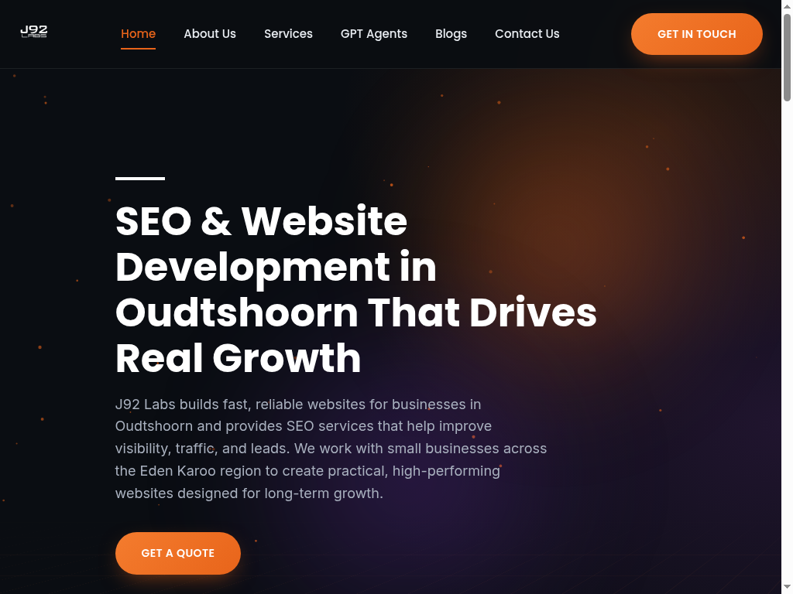
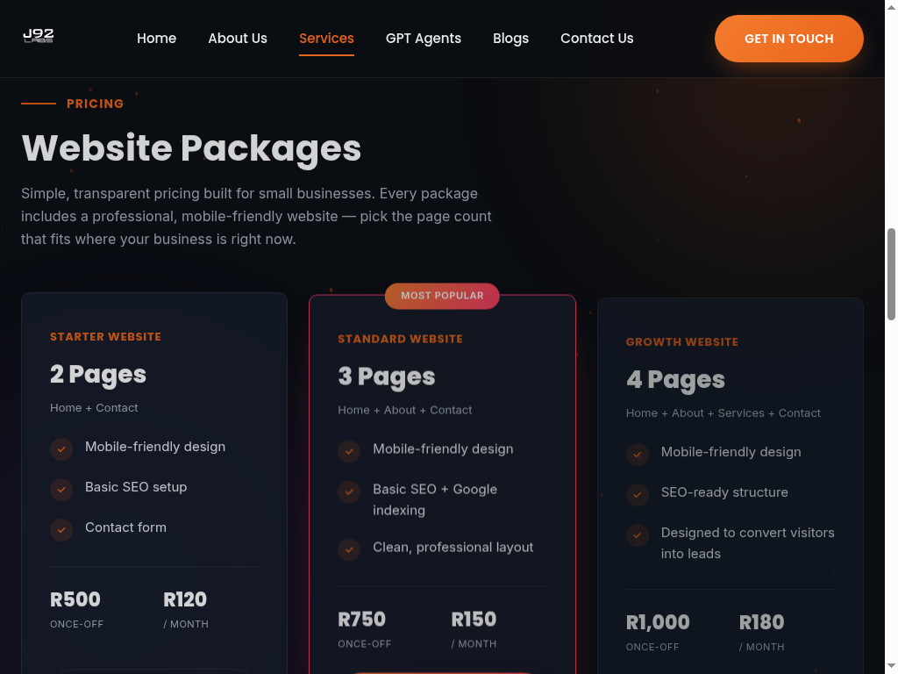
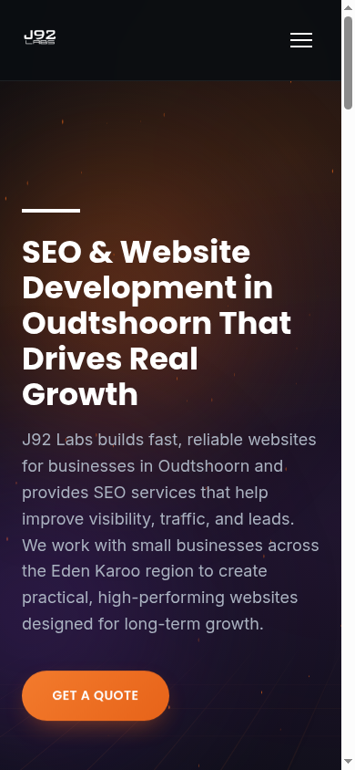

 # J92 Labs audit & Ruans-Web-Design website plan

> **Archive note:** This is the original audit, with screenshot links adapted for GitHub. The report labels 20 November 2026 as user-provided; the initial chat date was 22 November 2026. Neither establishes an exact capture time. For later decisions, including approved pricing and the final visual direction, see the [project handover](HANDOVER.md).

**Reference:** https://j92labs.co.za/ 
**Prepared for:** Ruans-Web-Design 
**Review date:** 20 November 2026 (user-provided date) 
**Scope:** Public pages, published services and prices, layout, HTML/CSS and visible SEO foundations. No website build or brand/domain availability research yet.

## Recommendation

Use J92 Labs as a reference for a small-business website sales funnel, not as a template to copy verbatim. Its strongest elements are clear package tiers, recurring hosting/support, prominent contact options, and an easy-to-follow process. Build your version around **website design, website improvements and maintenance**, with a consistent basic SEO setup included in every package—not a separate SEO service.

Display the temporary brand as **Ruan’s Web Design**. Keep **Ruans-Web-Design** as your existing GitHub identity. This is a presentation recommendation, not a researched or cleared business name.

### Key findings

- Six main pages are linked in the navigation and XML sitemap: Home, About Us, Services, GPT Agents, Blogs and Contact Us.
- The three website packages cost **R500 + R120/month**, **R750 + R150/month**, and **R1,000 + R180/month**. These are J92’s published prices, not recommendations for your business.[^2]
- The site includes titles, descriptions, one H1 on each main page, crawlable links, robots.txt and a sitemap. However, no canonical links, Open Graph/Twitter metadata or JSON-LD were found on the six inspected main pages.
- The Contact page offers phone, email and WhatsApp but no HTML form; a Starter package nevertheless advertises a contact form. This describes the agency’s own site, not proof that client deliverables lack forms.
- The blog currently says “New articles coming soon.” Do not replicate an empty blog or list AI services you do not intend to provide.

## 1. Site structure and visitor journey

| Page | What it contains | Role in the sales journey |
|---|---|---|
| `/` | Service/location headline, services, process, portfolio images, About, client logos, final CTA | Explain the offer and establish trust |
| `/about-us/` | Approach, story, services, regions, principles, business statistics | Reassure prospects about the provider |
| `/services/` | Service overview, process, three packages, extras, inclusions, benefits, FAQs, CTAs | Help visitors compare and choose |
| `/gpt-agents/` | Six AI assistant categories and custom-agent enquiry CTA | Separate AI-service proposition |
| `/blogs/` | Intro and coming-soon message | Intended education/content hub, currently inactive |
| `/contact_us/` | Intro, phone, email, location and WhatsApp | Direct enquiries |

**Observed visitor paths:**

1. Home → Get a Quote → Contact.
2. Services → View Packages → pricing section on the same page.
3. Package → Get Started → Contact.
4. Header Get in Touch → email application via `mailto:`.
5. WhatsApp → `wa.me` link; phone → `tel:` link.

The package buttons do not preserve the selected package in their destination URL. Your version should carry that selection into the quote form.

The footer repeats contact details and navigation across pages. The homepage uses “Oudtshoorn / Eden Karoo,” while About expands the focus to “Central Karoo / Garden Route,” with online delivery further afield. These are the reference business’s locations—not yours.[^1][^3]

## 2. Layout, visual design and formatting

### Desktop reference

**Visual language observed from the rendered site and CSS:**

- Near-black backgrounds, dark blue-grey cards, white headings and muted grey body text.
- Main orange accent around `#e8641a`, including button treatments; warm orange and purple glows in hero backgrounds.
- **Poppins** for headings and **Inter** for body text.
- Large, bold, left-aligned hero heading; uppercase eyebrow labels with short horizontal rules.
- Rounded pill buttons; thin card borders and generally modest card rounding.
- Homepage sections numbered **01–05**, creating an agency/editorial feel.
- Three-column service and pricing layouts on desktop, with responsive stacking.
- Services hero pairs its message with a CSS-built monitor mockup. Its miniature headings/text are decorative content, not another real page.
- Animated particles, grid/floor effects, reveal animations and GSAP/ScrollTrigger scripts. Reduced-motion handling exists in the CSS and animation script; its presence is a positive, not a full accessibility certification.
- Generous section spacing: commonly 96px vertical section padding in the inspected style rules. The homepage hero content is constrained to roughly 760px; lead text to roughly 560px.

### Homepage order

Header → hero/quote CTA → three services → three-step process → portfolio → About → client logos → closing CTA → footer.

This order moves from **offer → method → proof → provider → enquiry**. Your version should bring a pricing preview closer to the top so budget-sensitive prospects need not hunt for it.

### Pricing reference

The Standard card gets a “Most Popular” badge and coloured emphasis. Setup and monthly prices are side by side, separated from features. This comparison pattern is worth retaining, with original copy and your own visual identity.

### Mobile reference

The header becomes a hamburger menu. The long headline wraps heavily; the introduction and CTA occupy most of the opening mobile screen. CSS breakpoints are at 900px and 560px, reducing or stacking grids.

**Improve your version:** shorten the hero heading, keep introductory copy to two or three short sentences, make quote access prominent, and avoid decorative motion competing with readability. The screenshots are representative captures, not a complete multi-device test.

## 3. Published pricing and package terms

All amounts below are in **South African rand (ZAR)** and transcribed from J92’s Services page.[^2] The cards show both a once-off amount and a recurring amount; interpret them as setup **plus** monthly service, not alternatives.

| Package | Pages | Published inclusions | Once-off | Monthly | First 12 months* |
|---|---|---|---:|---:|---:|
| Starter | 2: Home + Contact | Mobile-friendly design, basic SEO setup, contact form | R500 | R120 | R1,940 |
| Standard | 3: Home + About + Contact | Mobile-friendly design, basic SEO + Google indexing, clean professional layout | R750 | R150 | R2,550 |
| Growth | 4: Home + About + Services + Contact | Mobile-friendly design, SEO-ready structure, lead-focused design | R1,000 | R180 | R3,160 |

*Calculated as setup + 12 monthly payments. These are arithmetic comparisons, not a quoted contract total; they exclude extras and any tax or billing conditions not stated on the inspected page.*

### Extras and upgrades

| Extra | Published price | Fit for your offer |
|---|---:|---|
| Google Business Profile setup | R300 once-off | Exclude initially: not a web-design deliverable under your stated scope |
| Google Business Profile updates | From R80/change | Exclude with the above service |
| Additional pages | R150/page | Suitable; define complexity and included content |
| Citations | R150 / 10 directories | Exclude: SEO/directory service |
| Blog & content distribution | R120/post | Do not copy wholesale; separate website publishing from writing/distribution |

**Advertised across all packages:** free consultation, free quarterly performance report, secure hosting, ongoing support and maintenance.

**FAQ details found in the page HTML:**

- Website ownership belongs to the client; the stated monthly fee is for hosting/support rather than ownership, with “no lock-in.”
- Packages can be upgraded and additional pages added.
- Starter and Standard are typically live within **1–2 weeks after receiving content**; Growth may take longer depending on scope.
- Clients provide core content; J92 guides them and helps refine wording.
- Monthly fee includes hosting, maintenance, security updates and a quarterly performance report.
- Continued SEO support is offered after launch, without a price listed in the inspected FAQs.

### What remains commercially unclear

The inspected pricing page does not clearly settle VAT treatment, domain registration/renewal costs, email hosting, storage/bandwidth limits, included editing allowance, revision rounds, cancellation notice, payment schedule, backup frequency or restoration terms. Do not infer these from “hosting included.” Obtain a provider quote if you need binding terms.

The page advertises “No large upfront costs,” but also shows setup fees. Your pricing should explicitly say **“Once-off build fee + monthly hosting and care”** to avoid ambiguity.

### Pricing advice for you

Use these prices as a **competitor benchmark only**. This is one provider, not a South African market survey. Matching them without estimating your design time, support time, hosting and payment costs could make your service unsustainable.

Before publishing your prices, calculate:

> Build price = estimated hours × sustainable hourly rate + direct costs + contingency. 
> Monthly care price = hosting/platform costs + expected support time + backup/security costs + margin.

Keep a clearly scoped entry-level offer, but do not promise unlimited changes. Choose your actual rates after this calculation; none are approved in this plan.

## 4. SEO basics: present, missing and unverified

This is an inspection of public output, not a ranking audit or access to J92’s Search Console. The six main URLs returned HTTP 200 during retrieval.

| Item | Observation | What your site should do |
|---|---|---|
| HTTPS | Inspected pages served over HTTPS | Use HTTPS and consolidate preferred host/URL variants |
| Page titles | Unique across the six main pages | Describe each page and include the brand naturally |
| Meta descriptions | Present and page-specific | Write useful, distinct summaries; avoid keyword stuffing |
| Main heading | One H1 per main page | Clear page-topic H1 and logical subsection headings |
| Heading hierarchy | Homepage jumps from H1 to service H3s | Use a Services H2 before individual H3 cards |
| Language/viewport | `en-ZA` and mobile viewport present | Set accurate language and responsive viewport |
| Internal links | Real anchors connect pages and CTAs | Maintain crawlable links and descriptive labels |
| robots.txt | Allows crawling; references sitemap | Publish an appropriate file; keep staging out of search |
| XML sitemap | Lists the six main navigation URLs | Include canonical, public, indexable URLs |
| Canonicals | None found on the six main pages | Add absolute self-referencing canonicals and URL consistency |
| Social previews | No Open Graph/Twitter tags found | Add title, description and a branded share image; this is share hygiene, not a ranking guarantee |
| Structured data | No JSON-LD found on those pages | Add accurate Organization or appropriate LocalBusiness data; no invented address/reviews |
| Image descriptions | Alt attributes exist; several are generic “Client logo” / “Client website project” | Name real projects and describe meaningful imagery; use empty alt for decoration |
| Image loading | Many portfolio/client images use lazy loading | Keep it for below-fold images; reserve image space to reduce shifting |
| Image dimensions | No HTML width/height attributes found on inspected images | Specify dimensions or equivalent stable CSS aspect ratios |
| Content depth | Blog currently empty | Launch a blog only when useful articles are ready |
| Local relevance | Strong location wording, varying regional emphasis | Use your real location/coverage consistently; don’t inherit Oudtshoorn claims |

**Interpretation:** J92 has a workable baseline, but “proper SEO” is broader than having keywords in headings. Missing canonical tags do not by themselves prove an indexing problem; structured data does not guarantee enhanced search results. Google recommends useful content, understandable page titles, crawlable links and discoverable URLs.[^7][^8][^9]

**Unverified:** rankings, traffic, conversion rate, backlinks, actual Google indexing, Search Console setup, field Core Web Vitals, full accessibility compliance and production uptime. No numerical performance score is claimed. Lazy images not loaded before scrolling are not treated as broken assets.

The page includes Microsoft Clarity. This plan does not verify its consent implementation or legal compliance; your tracking and enquiry-data handling need an appropriate privacy approach.

## 5. Your service scope

### Keep from the reference

1. **Small-business website design and development:** professional brochure websites with responsive layouts.
2. **Website maintenance and care:** hosting/support if you choose to provide and can sustain them.
3. **Website review and improvements:** layout, mobile usability, content clarity, technical health and basic SEO-foundation checks. J92 advertises website audits on About, but no audit price was found.
4. **Additional pages and upgrades:** transparent per-page or scoped quotes.
5. **Basic SEO with every website:** defined deliverables, not a separate paid SEO package.

### Do not inherit without a separate decision

- Monthly SEO campaigns, ranking guarantees, backlinks/citations or SEO strategy retainers.
- Google Business Profile services.
- GPT agents, marketing campaigns and content distribution.
- E-commerce, booking systems, membership portals or advanced applications: these were not published as named website packages in the inspected reference. Quote separately only if you decide to offer them.

**Recommended positioning:**

> Professional, mobile-friendly websites for small businesses—with basic SEO built in and reliable support after launch.

“Basic SEO included” should mean page titles/descriptions, heading structure, readable URLs, internal links, image descriptions, sitemap/robots setup, canonical URLs, mobile checks and reasonable performance optimisation. Search Console verification/submission can be included when the client grants access. **Google indexing and rankings cannot be guaranteed.**[^10]

## 6. Proposed website plan: Ruan’s Web Design

### Navigation and page map

**Home · Services & Pricing · Work · About · Contact**, plus a primary **Get a Quote** button.

| Proposed URL | Required content |
|---|---|
| `/` | Offer, service summary, package preview, actual work, process, basic SEO inclusion, FAQ preview, CTA |
| `/services/` | Full package comparison, website improvements, maintenance, extras, scope exclusions and FAQs |
| `/work/` | Your real projects with screenshots, your role and scope; label concepts/demos clearly |
| `/about/` | Your story, working style, real location/coverage, skills and honest credentials |
| `/contact/` | Quote form, your confirmed email/WhatsApp, response expectations and privacy notice |
| `/privacy/` | Explain enquiry-data handling and analytics/tracking used |
| `/terms/` | Actual ownership, payment, revisions, hosting/care, cancellation and handover terms |

If no project examples are available, fold one honest demo section into Home and omit Work until it has substance. Privacy/Terms are proposed supporting pages, not necessarily billable pages within client packages.

### Homepage wireframe, in order

1. **Header:** original wordmark, compact navigation, quote CTA, accessible mobile menu.
2. **Hero:** “Websites that make your business look professional.” Short supporting line about mobile-friendly design and included SEO foundations. Buttons: **View Packages** and **Get a Quote**.
3. **Benefits:** mobile-friendly, clear pricing, basic SEO included, direct support—only promises you can deliver.
4. **Services:** new websites, website improvements, maintenance/support. Explain SEO inclusion beneath these rather than making it an SEO-service card.
5. **Package preview:** Starter / Business / Growth, page counts, build fee + monthly fee if applicable, key inclusions and package-specific quote buttons.
6. **Work:** two or three genuine examples, or clearly labelled demonstration projects.
7. **Process:** discuss → design/build → review/launch → support. State where client content and approval are required.
8. **About preview:** a short personal introduction, not invented client statistics.
9. **FAQs:** ownership, timings, content, revision allowance, monthly costs and what SEO includes.
10. **Closing CTA and footer:** quote/WhatsApp, contact details, navigation, privacy and terms.

### Package architecture—not approved pricing

| Tier | Suggested brochure-page structure | Common essentials |
|---|---|---|
| Starter | Home + Contact | Responsive design, functioning enquiry form, basic SEO, agreed revisions |
| Business | Home + About + Contact | Same essentials; greater room for business story/trust |
| Growth | Home + About + Services + Contact | Same essentials; dedicated service detail and stronger enquiry journey |

Use consistent SEO inclusion in every tier. Differentiate by page count, content scope and design complexity—not by implying an entry-level website lacks fundamental search hygiene. State whether hosting/care is required or optional, and price it separately and visibly.

### Contact form requirements

- Name, email, business name, package/service interest and project message; phone can be optional.
- Preserve selected package from the pricing card.
- Accessible labels, validation, spam protection and clear success/error states.
- Route enquiries to a confirmed destination and test real delivery before launch.
- Provide a privacy notice; do not automatically subscribe enquiries to marketing.

## 7. Design direction and naming

Retain the reference’s **clarity and conversion structure**, not its logo, project images, testimonials or wording. A dark theme with a strong accent is a viable direction, but your final palette/typeface choice remains open; a screenshot/reference selection should happen before building.

Use a shorter hero, less visual motion, readable card copy and more consistent type sizes. Build equal-height package cards, obvious focus states, contrast-checked text and comfortable mobile tap targets.

**Temporary public brand:** Ruan’s Web Design. 
**Existing identity:** Ruans-Web-Design. 
**Not researched:** trademark/company-name conflicts, domains, social handles or GitHub profile content. No availability claim is made. Avoid buying a domain before basic brand checks.

## 8. Build readiness and acceptance checklist

Before a build, resolve: your actual contact details, location/coverage, approved rates, hosting/care model, content ownership, revisions, real work examples and final visual direction. Do not publish placeholders as facts.

**Launch acceptance criteria:**

- Every page has accurate original content, distinct metadata, logical headings and working links.
- No empty blog, fake reviews, copied client logos or unprovided service claims.
- Quote forms deliver successfully; package selection and WhatsApp/phone/email links work.
- Prices distinguish once-off and recurring charges and state tax/domain assumptions.
- Mobile and keyboard journeys tested; reduced-motion preference respected.
- Images optimised, with meaningful alt text and stable dimensions/aspect ratios.
- HTTPS, preferred URLs, canonicals, robots.txt and sitemap verified in production.
- Social previews and accurate business structured data checked.
- Search Console verification/submission performed where authorised, without promising indexing.
- Privacy/terms reflect real operations; analytics configured deliberately.
- If maintenance is sold, backups, restore process and support responsibilities are documented.

## Methodology and limitations

Read all six main public pages in a browser, saved rendered text and HTML, inspected page headings/metadata/links/forms, retrieved robots.txt and sitemap.xml, inspected shared styles and animation code, and captured desktop/mobile layout references. The evidence files accompany this report’s workspace. No form was submitted, no private account accessed and no intrusive security testing performed.

J92 prices, service descriptions, timings and business-history claims are **single-source provider statements**, not independently verified commercial promises. Its claim of 16 clients and establishment in 2025 was not independently checked and must not be reused for your brand. Google Search Central provides authority for SEO recommendations. A search query returned no useful J92 result; that does not prove the site is unindexed.

This is a focused audit and planning brief, not a full competitive market study, legal review or exhaustive crawl of every possible unlinked URL.

## References

J92 pages retrieved during this audit; review dated 20 November 2026 as supplied by the user.

[^1]: J92 Labs, homepage: https://j92labs.co.za/
[^2]: J92 Labs, Services & Pricing, including package cards and FAQ HTML: https://j92labs.co.za/services/
[^3]: J92 Labs, About Us: https://j92labs.co.za/about-us/
[^4]: J92 Labs, Contact Us: https://j92labs.co.za/contact_us/
[^5]: J92 Labs, GPT Agents and Blogs: https://j92labs.co.za/gpt-agents/ and https://j92labs.co.za/blogs/
[^6]: J92 Labs, crawl files: https://j92labs.co.za/robots.txt and https://j92labs.co.za/sitemap.xml
[^7]: Google Search Central, SEO Starter Guide: https://developers.google.com/search/docs/fundamentals/seo-starter-guide
[^8]: Google Search Central, canonical URL guidance: https://developers.google.com/search/docs/crawling-indexing/consolidate-duplicate-urls
[^9]: Google Search Central, Build and Submit a Sitemap: https://developers.google.com/search/docs/crawling-indexing/sitemaps/build-sitemap
[^10]: Google Search Central, Ask Google to Recrawl Your URLs: https://developers.google.com/search/docs/crawling-indexing/ask-google-to-recrawl
